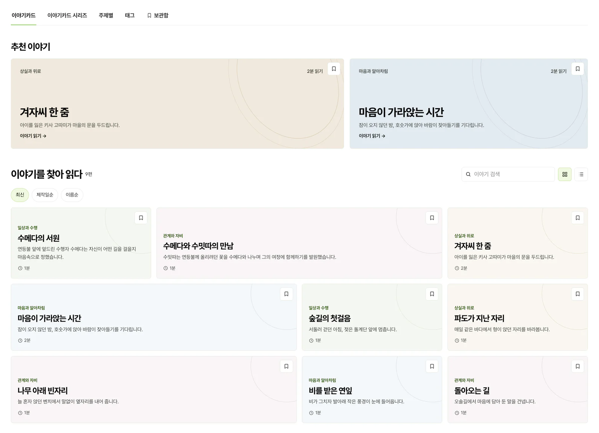
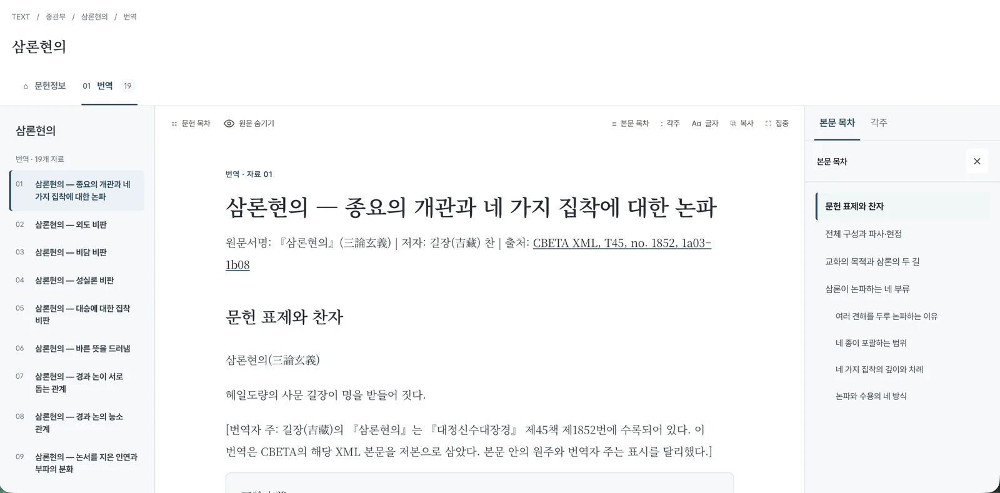
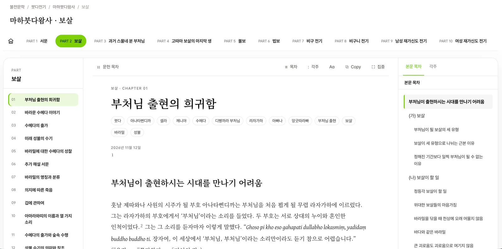
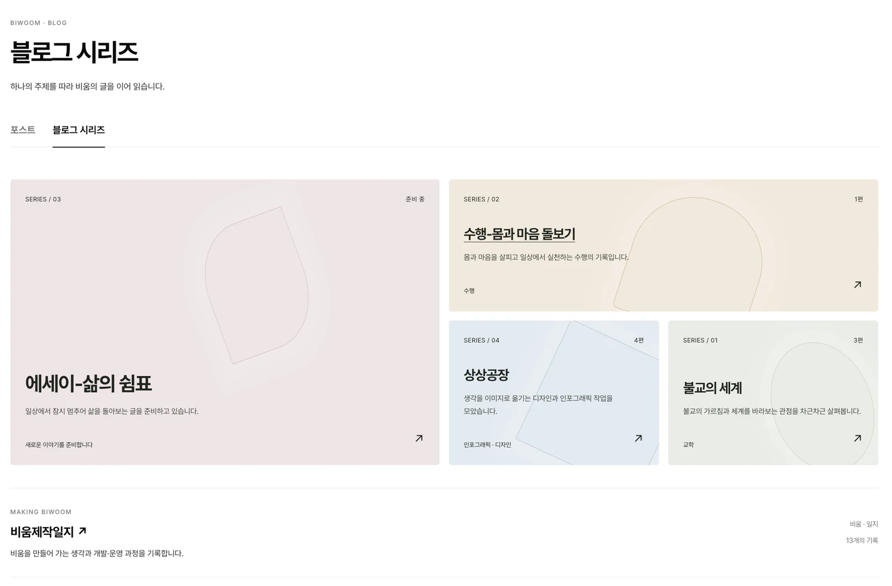

<div align="center">
  
  <h1>비움 · BIWOOM</h1>
  <p><strong>붓다의 지혜를 오늘의 삶으로</strong></p>
  <p>한 출가 수행자의 공부와 번역에서 시작한 열린 불교 서재입니다.<br>문헌과 이야기에서 만난 가르침을 읽고, 사유하고, 일상에서 실천합니다.</p>
  <p>
    <a href="https://biwoom.github.io/"></a>
    <a href="https://biwoom.github.io/pages/brand/"></a>
  </p>
  <p>
    <a href="https://github.com/biwoom/biwoom.github.io/actions/workflows/deploy.yml"></a>
    <a href="astro.config.mjs"></a>
    <a href="package.json"></a>
    <a href="content/pages/cc0.md"></a>
  </p>
</div>

## 비움을 둘러보기

<table width="100%">
  <tr>
    <td width="50%" valign="top">
      <a href="https://biwoom.github.io/articles/"></a><br>
      <strong><a href="https://biwoom.github.io/articles/">이야기카드 →</a></strong><br>
      삽화가 있는 짧은 이야기에서 인물의 선택을 따라갑니다. 전문에서는 이야기 전체와 출전을 살펴볼 수 있습니다.
    </td>
    <td width="50%" valign="top">
      <a href="https://biwoom.github.io/text/"></a><br>
      <strong><a href="https://biwoom.github.io/text/">불교경론 →</a></strong><br>
      경전과 논서의 원문·번역을 대조하며 읽습니다. 문헌별 연구에서 개념과 사상적 맥락을 더 살펴봅니다.
    </td>
  </tr>
  <tr>
    <td width="50%" valign="top">
      <a href="https://biwoom.github.io/story/"></a><br>
      <strong><a href="https://biwoom.github.io/story/">불전문학 →</a></strong><br>
      붓다와 고승의 전기, 본생담과 설화, 순례기와 게송을 원전과 번역으로 읽습니다.
    </td>
    <td width="50%" valign="top">
      <a href="https://biwoom.github.io/blog/series/"></a><br>
      <strong><a href="https://biwoom.github.io/blog/series/">블로그 · 틈과 여백 →</a></strong><br>
      불교 교학과 일상의 수행, 디자인 작업과 비움을 만들어 가는 과정을 주제별로 읽습니다.
    </td>
  </tr>
</table>

삽화·인포그래픽·문양은 [미디어](https://biwoom.github.io/media/)에서 살펴볼 수 있습니다. 내려받아 읽을 수 있는 EPUB과 PDF는 [전자책](https://biwoom.github.io/ebook/)에 모았습니다.

## 비움의 운영과 참여

비움은 한 출가 수행자가 불교문헌을 공부하고 연구·번역한 성과를 나누기 위해 시작한 독립 프로젝트입니다. 운영자 개인이 책임을 맡아 개발하고 유지하며, 그 바탕에는 승가 공동체의 가르침과 돌봄, 불자들의 보시가 있습니다. 운영자는 수행과 생활을 뒷받침하는 보시 가운데 그 사용 목적에 맞는 여유 재원의 일부를 연구와 번역, 콘텐츠 제작, 웹 서비스 운영에 씁니다. 받은 도움을 다시 누구에게나 열려 있는 배움으로 돌려주는 것이 비움의 운영 취지입니다. [운영 및 기여](content/pages/support.md)

> **받은 보시를 지혜의 나눔으로, 지혜의 나눔을 다시 세상의 이익으로.**

| 운영 원칙 | 비움에서 이어 가는 일 |
| --- | --- |
| **개방성** | 공개 자료는 가입이나 후원 없이 누구나 읽을 수 있습니다. 별도 조건이 없는 비움 자체 제작 자료에는 CC0 1.0을 적용합니다. 제3자의 권리와 자료에 명시된 조건을 존중합니다. [CC0 안내](content/pages/cc0.md) |
| **자발성** | 읽고 사유하고 나누는 일도 기여입니다. 오류 제보, 자료 소개, 번역·검수, 창작·교육과 웹 접근성 개선에 관한 제안을 환영합니다. [문의 및 제안](content/pages/contact.md) |
| **책임성** | 출처와 맥락을 확인할 수 있는 자료를 이해하기 쉬운 말로 전합니다. 기존 자료의 오류를 바로잡고 보존하며, 누구나 편안하게 찾고 읽을 수 있도록 검색과 모바일 열람을 개선합니다. [비움 소개](content/pages/brand.md) |

## 개발과 집필

Node.js 22.12 이상에서 저장소 루트를 열고 실행합니다. 원고는 Obsidian의 `content/` 보관함에서 작성하고, 사이트 구현은 `ol-core/`에서 관리합니다.

```sh
npm ci
npm run dev
```

[콘텐츠 관리 매뉴얼](.agents/references/biwoom-content-management-manual.md) · [이야기카드 설계](.agents/context/biwoom-story-card-specification.md) · [에이전트 작업 지침](AGENTS.md)

<details>
<summary><strong>저장소 구조와 배포 방식</strong></summary>

### 사이트와 저장소

- 사이트: https://biwoom.github.io/
- 저장소: `biwoom/biwoom.github.io`
- Node.js: 22.12 이상
- 배포: GitHub Actions → GitHub Pages 루트 `/`

공개 주소는 `site-config.mjs`의 `SITE_URL`에서 관리합니다. 공개·개발·미리보기는 루트에서 시작합니다. 레지스트리의 문서 경로는 유지하며 예전 `/hub/` 주소에는 이관 안내를 생성합니다. 배포는 `biwoom/biwoom.github.io`의 Settings → Pages에서 GitHub Actions를 소스로 사용합니다.

### 폴더 구조

```text
content/                 # Obsidian 보관함·문서·원본 첨부
ol-core/
├── src/                 # Astro 페이지·컴포넌트·스타일·content.config.ts
├── scripts/             # 콘텐츠 처리·자산 동기화·검사
└── public/              # 고정 자산과 generated/ 파생 자산
astro.config.mjs         # 루트 Astro 설정
package.json             # 루트 개발·빌드 명령
site-config.mjs          # 브랜드·운영 URL·기본값
content-registry.json    # 문서 식별자·주소·날짜·이력
```

저장소 루트에서 기존 `npm run dev`, `npm run build` 명령을 그대로 사용합니다. 빌드 결과는 `dist/`에 생성됩니다. 경로 기준은 `ol-core/scripts/lib/paths.mjs`에서 관리합니다. 보관함 상대 경로와 레지스트리 키는 NFC로 통일하여 macOS의 자모 분해형 파일명과 Linux의 Git 체크아웃이 같은 메타정보를 사용합니다. 실제 파일명·본문·기존 문서 주소는 바꾸지 않습니다. 기존 Obsidian 보관함은 위치만 `content/`로 옮겼으므로 해당 폴더를 보관함으로 다시 열어 사용합니다. `.obsidian` 내용은 유지하며 Git에서는 제외합니다.

</details>

<details>
<summary><strong>Obsidian 집필, 공개 범위와 문서 주소</strong></summary>

### 집필

모든 페이지의 상단과 모바일 메뉴는 **카드 · 경론 · 문학** 순서입니다. 비움 이름을 누르면 홈으로 돌아갑니다. 불교경론은 `/text/`, 불전문학은 `/story/`에서 엽니다. Obsidian의 집필 폴더 이름도 각각 `text`, `story`입니다.

Obsidian에서 `content/`를 보관함으로 엽니다. Vault CMS나 다른 CMS는 필요하지 않습니다.

```text
content/
├── text/001.중관부/001.대승현론/
│   ├── 01.번역/001.1권.md
│   └── 02.연구/001.대승현론 제1권 연구.md
├── story/001.붓다전기/001.마하붓다왐사/01.서문/01-01-예경과 저술의 서원.md
├── blog/005.비움제작일지/006.일지/작업 기록.md
├── pages/brand.md
└── media/001.인포그래픽/lamrim-preview1.jpg
```

제목과 본문만 작성해도 됩니다.

```markdown
# 대승현론 제1권

본문을 작성합니다.

## 소제목
```

첫 H1을 제목으로 사용하며, H1이 없으면 파일명에서 번호·확장자를 뺀 이름을 사용합니다. 기존 `title` 예외가 있으면 우선합니다. `001.md`처럼 번호만 있는 파일은 본문에 H1 제목을 작성하세요.

폴더·파일의 `001.` 같은 숫자는 정렬에 사용하고 화면에서는 숨깁니다. `/text/`는 문헌 목록, `/story/`는 작품 카드가 기본입니다. 각 메뉴의 카테고리 탭은 별도 페이지로 이동하며, 카테고리 카드에서 해당 문헌·작품 목록을 엽니다. 기본 화면 하단에는 기존 읽기 화면으로 연결되는 최근 공개 글을 최대 세 편 표시합니다. 두 메뉴 모두 최상위 폴더는 카테고리입니다. 빈 카테고리를 Git에 보관하려면 해당 폴더에 `.gitkeep`을 둡니다. 문헌 화면의 자료 구분 버튼은 첫 자료로 이동하며, 전체 자료는 펼침 목록으로 표시됩니다. 번역과 연구는 독립적인 목록입니다. TEXT 문헌·문서 화면은 청회색 학술형 구성과 명조 본문, 데스크톱 3단 보조 패널 및 집중 모드를 제공하며, STORY와 각주·글자 크기·복사 동작을 공유합니다.

소개가 필요하면 문헌 또는 시리즈 폴더에 `index.md`를 추가합니다. 필수는 아닙니다. 대표 이미지·태그·설명도 필수가 아닙니다. 태그를 쓰려면 `tags: [수메다, 수밋따]`처럼 접두어 없이 작성합니다. TEXT·STORY·BLOG 개별 문서의 제목 아래에 해당 문서의 태그만 표시하며, 시리즈 태그는 상속하지 않습니다. BLOG 메뉴에서는 태그 버튼과 연도 필터를 함께 사용할 수 있습니다.

BLOG는 `blog/시리즈/카테고리/포스트` 구조이며 카테고리는 하나의 시리즈에 속합니다. 시리즈·카테고리의 `index.md`에는 제목·소개와 선택적 표지를 작성합니다. `/blog/`는 포스트 목록, `/blog/series/`는 무작위 비대칭 시리즈 표지와 고정 비움제작일지 영역입니다. 시리즈 상세 목차와 포스트의 이전/다음은 같은 읽는 순서를 사용합니다. 에세이는 사용자의 향후 집필을 위해 소개만 준비했습니다. 구체적인 소속·메타정보·순서 작성법은 콘텐츠 관리 매뉴얼을 따릅니다.

### 초안·첨부파일

- `_drafts/`와 `_templates/`, `.obsidian/`은 사이트에서 제외합니다.
- 공개용 메뉴 폴더의 문서는 기본 공개 대상입니다. 로컬 편집 내용은 업로드·배포 후 실제 사이트에 반영됩니다.
- 기존 `published: false`는 유지됩니다. 시리즈의 `index.md`가 비공개이면 하위 문서도 숨깁니다.
- `_drafts`와 `published: false`는 사이트 출력 범위를 정합니다. 접근 제한이 필요한 조사·검수·승인 기록은 배포 저장소 밖의 제한된 공간에 보관합니다.
- 개별 자료로 보여줄 PDF·이미지·HTML은 자료 구분 폴더에 직접 둡니다.
- 여러 문서에서 쓰는 이미지는 `content/media/`에 보관합니다. 최상위 폴더가 미디어 카테고리가 됩니다. 현재 이미지는 `001.인포그래픽`(5개), `002.문양`(5개), `003.일러스트`(2개)에 분류되어 있습니다. 숫자는 정렬에만 쓰며, 루트에 직접 놓은 이미지는 미분류로 표시됩니다. `blog/기록.md`에서는 ``처럼 일반 Markdown 상대 링크로 참조합니다. 상단 메뉴에는 표시하지 않으며 비움프리뷰탭의 미디어&ebook과 푸터에서 `/media/` 모음으로 이동할 수 있습니다. 카테고리 버튼으로 masonry 목록을 분류하고 이미지를 누르면 같은 페이지의 모달에서 원본을 확대합니다. 카테고리의 `index.md`에 `## [이미지 제목](파일명)`과 설명을 여러 항목으로 작성하면 각 이미지 모달에 표시됩니다. 세 카테고리의 index.md를 작성 예시로 참고할 수 있습니다. 자산별 상세 문서·검색 항목은 생성하지 않습니다.
- 문서 전용 보조 파일은 문서 옆 `assets/`에 두고 일반 Markdown 상대 링크로 연결합니다.
- YAML은 선택 사항입니다. 날짜·권리·설명 등의 예외에만 사용합니다. 위키링크·Obsidian 블록 임베드는 현재 지원하지 않으므로 일반 Markdown 링크를 사용하세요.

### 주소와 날짜

`content-registry.json`은 자동 관리되는 원본 색인입니다. 문서 URL·최초 공개 준비일·해시·문헌 주소·과거 경로 매핑을 보존하므로 콘텐츠와 함께 Git에 보관합니다. 빌드 산출물이 아닙니다. 기본 작성자·언어·권리는 `site-config.mjs`에서 관리하며 개별 권리 예외를 우선합니다.

일반적인 이동·개명은 내용 해시로 감지해 문서 주소를 유지합니다. **개발 서버를 끈 상태에서 이동과 본문 편집을 함께 수행하면** 자동 식별이 안 될 수 있습니다. 이 경우 준비·빌드 전에 다음 명령으로 기존 문서를 연결하세요.

```sh
npm run content:move -- "text/이전경로.md" "text/새경로.md"
```

같은 내용의 문서가 여러 개이면 자동 이동 감지는 모호할 수 있습니다. 파일명 접두어를 변경해도 내용이 유지되면 주소를 보존합니다. 문헌 폴더 전체 이동도 기존 색인이 있는 상태에서 처리하세요. BLOG의 기존 날짜는 보존되며, 새 공개 문서는 처음 준비할 때 날짜를 기록합니다. 정확한 과거 발행일이 필요하면 선택적으로 `date`를 지정합니다.

비공개 첨부는 비공개 `index.md`가 있는 전용 폴더 또는 `_drafts`에 둡니다. 공개 글도 참조하는 공유 첨부는 공개입니다. `_assets`를 제외한 `_` 경로는 배포하지 않습니다. 상세 공개 범위는 관리 매뉴얼을 따릅니다.

소개 문서의 주소는 문헌 주소와 같습니다. 최초 공개 준비일은 한국 날짜를 사용합니다. registry가 사라졌다면 Git에서 복원하세요. 신규 보관함만 `npm run prepare:content -- --init`으로 생성합니다. 콘텐츠 변경과 registry를 함께 커밋하고 `npm run check:registry`로 확인합니다.

</details>

<details>
<summary><strong>검사 명령과 OL 코어</strong></summary>

### 개발·검증

```sh
npm run check
npm run typecheck
npm run build
npm run check:built
```

`npm run check:dev`는 임시 프로젝트와 로컬 개발 서버로 콘텐츠 갱신을 확인합니다. `check:live`는 기존 명령의 호환 별칭입니다. `check:built`는 로컬 `dist/`를 대상으로 합니다.

- `ol-core/scripts/lib/content.mjs`: 이름·본문·경로의 공통 해석
- `ol-core/src/content.config.ts`: 정규화된 데이터 스키마와 로더
- `ol-core/scripts/prepare-content.mjs`: 고정 주소·날짜 색인 관리
- `ol-core/src/lib/library.ts`: 공통 계층과 자료 목록
- `ol-core/scripts/remark-content.mjs`: 제목 중복 방지·내부 링크 변환
- `ol-core/scripts/sync-content-assets.mjs`: 일반 첨부파일 동기화
- `ol-core/public/generated/content/`: 파생 자산. 직접 수정하거나 커밋하지 않음

DESIGN·NET·엔터티·온톨로지 전용 기능은 제거했습니다. 기존 시각자료와 설명은 일반 자료로 이관한 뒤 사용자 요청으로 일부 삭제되었습니다. 현재 공개 목적지가 존재하는 과거 주소만 안내합니다. ATLAS 이관의 근거는 `.agents/references/content-migration-inventory.json`과 작업 기록에 남아 있습니다.

자세한 집필 규칙은 [비움 콘텐츠 관리 매뉴얼](.agents/references/biwoom-content-management-manual.md), 개편 기록은 [Obsidian 구조 개편 가이드](.agents/references/obsidian-content-refactor-guide.md)를 확인하세요.

</details>

<details>
<summary><strong>이야기카드, 브랜드 자산과 전자책 관리</strong></summary>

### 이야기카드

상단 **카드** 메뉴와 첫 화면·푸터의 **이야기카드** 링크는 `/articles/`로 연결됩니다. 원고는 `content/article/카테고리/원고.md` 또는 `content/article/카테고리/시리즈/원고.md`에 둡니다. 공개할 원고에는 `published: true`를 지정합니다. 원고의 `id`는 상세 주소와 보관함에 쓰입니다. 삽화는 `content/illustration/`에 두고, 원고의 `illustration.file`과 `illustration.alt`에 경로와 대체 텍스트를 적습니다.

삽화와 짧은 이야기를 담은 HTML 카드는 `content/article/html/`에 한 편씩 저장합니다. `data-article-id`를 Markdown 원고의 `id`와 맞추고 `data-card-date`에 카드 날짜를 적습니다. 홈과 카드 메뉴는 공개 원고에 연결된 최신 HTML 카드를 최대 다섯 장 사용합니다. 홈에서는 비움프리뷰탭 아래에 넓은 화면에서 두 장, 좁은 화면에서 한 장을 표시합니다. 표시 칸보다 카드가 많으면 5초마다 한 장씩 넘기며, 카드를 누르면 전문이 열립니다. 추천 이야기는 `content/article/index.md`에서 관리합니다. [비움 이야기카드 설계 문서](.agents/context/biwoom-story-card-specification.md)

웹용 카드는 HTML로 제작하고, 새로 추가하거나 교체하는 삽화는 원본을 보존한 뒤 WebP로 내보냅니다. 완성 카드 PNG는 공유·배포에 사용합니다.

### 브랜드 자산

비움은 기존 심볼 `ol-core/public/brand/biwoom-mark-monochrome.png`(제공 원본 004)와 `biwoom-mark-gold.png`(006)를 사용합니다. `npm run brand:assets`로 파비콘·ICO·Apple 아이콘·공유 이미지를 재생성합니다. 공개 영문 표기는 `BIWOOM`이며 OL은 내부 코어 이름입니다.

### 전자책

`content/ebook/카테고리/책이름/`에 표지 이미지와 EPUB 또는 PDF를 넣으면 `/ebook/` 라이브러리에 등록됩니다. 비움에서 CC0로 공개할 수 있는 책을 등록하고, 번역·표지·삽화·글꼴의 재배포 조건을 확인합니다. 별도 권리가 적용되는 요소는 배포 파일과 `index.md`의 서지·소개에 명시합니다. 비움프리뷰탭의 미디어&ebook과 푸터 MEDIA 아래의 EBOOK에서 접근하며, 책을 선택하면 다운로드 모달이 열립니다.

</details>

## 수정 변경사항

문서 버전 v1.20 · 2026-11-28 · 비움 (OL 코어)

<details>
<summary>README 개정 이력</summary>

### 2026-11-28 — v1.20

- 금색 심볼, 사이트 버튼, 배포·기술·이용 안내 배지와 네 메뉴의 화면 미리보기를 추가했습니다. 운영 원칙과 기여 방법을 앞에 두고, 상세 집필·개발 안내를 펼침 영역에 담았습니다.

### 2026-11-28 — v1.19

- 비움의 출발점과 운영 기반, 개방성·자발성·책임성을 소개하고 운영 및 기여·문의·CC0 안내를 연결했습니다.

### 2026-11-27 — v1.18

- 전체 페이지의 PC·모바일 주 메뉴 순서를 통일했습니다.

### 2026-11-27 — v1.17

- 홈에 비움프리뷰탭과 반응형 오늘의 이야기카드 캐러셀을 추가했습니다.

### 2026-11-27 — v1.16

- 오늘의 이야기에서 최신 HTML 카드를 캐러셀로 보여 주고 전문으로 연결합니다.

### 2026-11-27 — v1.15

- 웹용 이야기카드의 WebP 삽화 제작 기준을 추가했습니다.

### 2026-11-27 — v1.14

- HTML 이야기카드 추가와 추천 설정을 안내하고 설계 문서를 연결했습니다.

### 2026-11-26 — v1.13

- 경론·문학·카드 메뉴와 이야기카드 명칭을 반영했습니다.

### 2026-11-26 — v1.12

- 문헌과 대중용 이야기를 단일 사이트로 통합하고 루트 배포 주소를 기록했습니다.

### 2026-11-26 — v1.11

- 한국어 메뉴와 불교경론·불전문학의 공개 이름을 반영했습니다.

### 2026-11-26 — v1.10

- HUB와 HOME의 역할 및 주소 설정, 현행 집필 경로, 전자책 공개 조건, 로컬 검증 명령을 반영했습니다.

### 2026-11-25 — v1.9

- HUB 저장소·공개 배포 경로와 HOME 연결을 반영했습니다.

### 2026-11-13 — TEXT·STORY 메뉴

- 문헌 목록과 작품 카드, 별도 카테고리 페이지, 최근 공개 글 링크를 반영했습니다.

### 2026-11-11 — v1.7

- 한글 경로의 NFC/NFD 차이로 Actions 레지스트리 검사가 실패하던 문제를 수정했습니다. 기존 식별 정보는 유지합니다.

### 2026-11-11 — v1.6

- BLOG 시리즈·카테고리 구조, index 소개, 포스트·시리즈 페이지와 이어 읽기를 추가했습니다.

### 2026-11-09 — v1.5

- 콘텐츠를 content/, 구현을 ol-core/로 분리했습니다. 루트 실행 명령·레지스트리·배포 URL은 유지하고 경로·보관함 안내를 갱신했습니다.

### 2026-11-09 — v1.4

- MEDIA 썸네일 원본 3개를 삭제하여 이미지 수를 12개로 정리했습니다.

### 2026-11-09 — v1.3

- MEDIA 카테고리 index.md의 이미지별 제목·설명 작성법과 모달 표시를 반영했습니다.

### 2026-11-09 — v1.2

- MEDIA 최상위 카테고리와 이미지 분류 위치, 상대 링크 예시를 갱신하고 EBOOK 카테고리 구조를 반영했습니다.

### 2026-11-09

- 브랜드명·기본 도메인·심볼 경로와 GitHub Pages 사용자 도메인 해제 절차를 갱신했습니다.

</details>
