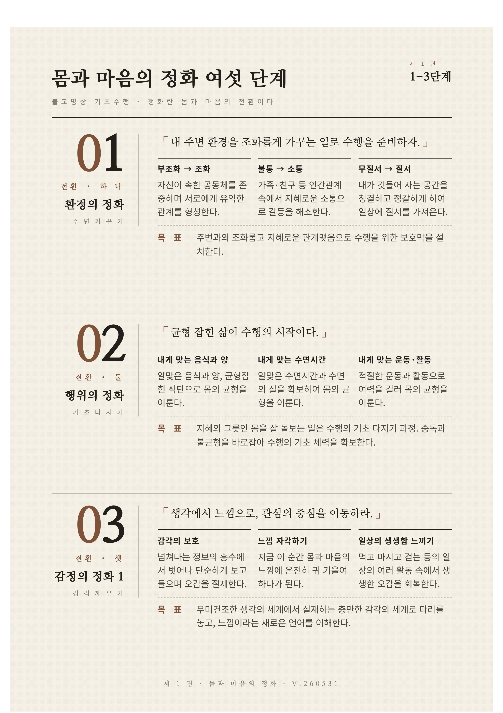

# 몸과 마음의 정화 여섯 단계

불교명상 기초수행에서 몸과 마음의 전환을 여섯 단계로 정리한 A4 인포그래픽.

몸과 마음의 정화를 여섯 단계로 나누어 안내하는 불교명상 기초수행 인포그래픽입니다.

환경, 행위, 감정, 의지, 생각의 전환을 단계별 수행 항목으로 정리해 입문자가 실천 흐름을 따라갈 수 있도록 구성했습니다.

## 자료

- [index.html](<./assets/index.html>)
- [preview1.jpg](<./assets/preview1.jpg>)
- [preview2.jpg](<./assets/preview2.jpg>)
- [six-steps-infographic.pdf](<./assets/six-steps-infographic.pdf>)
- [thumb.jpg](<./assets/thumb.jpg>)

## 출처·제작

OL Project · 비움